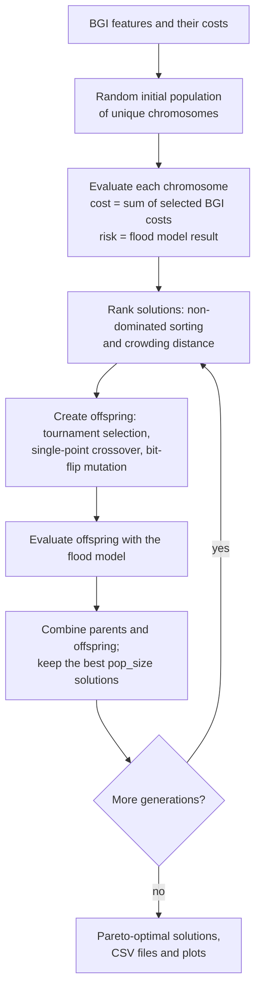

# CONFIGURE v1.0

**Cost-benefit OptimisatioN Framework for Implementing blue-Green infrastructURE**: multi-objective optimisation (NSGA-II) of Blue-Green Infrastructure (BGI) placement, coupled with a flood model.

[](https://github.com/asidurrehman/Configure10/actions/workflows/tests.yml)
[](LICENSE)
[](https://doi.org/10.1016/j.jhydrol.2024.131571)
[](https://www.python.org/)

This repository contains the Python code for CONFIGURE version 1.0, described in the article **Multi-objective optimisation framework for Blue-Green Infrastructure placement using detailed flood model** (*Journal of Hydrology*, 2024): https://doi.org/10.1016/j.jhydrol.2024.131571. An open-access preprint is available on [arXiv (2310.13989)](https://arxiv.org/abs/2310.13989).

## Overview

CONFIGURE integrates a multi-objective optimisation algorithm (NSGA-II) with a hydrodynamic flood model to optimise the cost and benefit of BGI interventions. The decision variables are the locations of BGI features: each candidate solution switches a set of BGI features on or off, and the framework searches for the solutions that best trade off **intervention cost** against **flood risk**.

CONFIGURE can be run in two modes:

- **Standard mode** (`configure10_standard.py`) evaluates candidate solutions one after another.
- **Parallelised mode** (`configure10_parallelised.py`) uses Python's `multiprocessing` to run several evaluations (hydrodynamic simulations) at the same time, which speeds up the optimisation.

Please refer to the article to decide when to use the standard or parallelised mode.

Out of the box, the code runs a **demonstration** with 100 hypothetical BGI features, random costs and a random risk value in place of a flood model, so you can try it straight away. To use it for a real study, you supply your own BGI costs and connect your own flood model (see [Using your own flood model](#using-your-own-flood-model)).

## How it works

Each candidate solution (chromosome) is a string of 0s and 1s with one gene per BGI feature: `1` means the feature is built, `0` means it is not.



## Repository structure

```text
Configure10/
├── configure10_standard.py       # entry script: standard mode
├── configure10_parallelised.py   # entry script: parallelised mode
├── configure10_functions.py      # NSGA-II helper functions shared by both modes
├── config.yaml                   # settings: output folder, population size, generations, ...
├── tests/                        # automated tests (pytest)
├── environment.yaml              # conda environment
├── requirements.txt              # pip requirements
├── pyproject.toml                # project metadata and tool settings
├── CITATION.cff                  # citation information
├── CHANGELOG.md
└── LICENSE                       # Apache License 2.0
```

## Requirements

- Python 3.10 or newer
- NumPy, pandas, Matplotlib and PyYAML (installed below)
- **For a real study: a flood model.** The article couples CONFIGURE with the CityCAT hydrodynamic model, which is **not** included in this repository. Any flood model that you can run from Python and that returns a risk value for each candidate solution can be used. The demonstration runs without one.

## Installation

Download the code:

```bash
git clone https://github.com/asidurrehman/Configure10.git
cd Configure10
```

Then create an environment with **either** conda:

```bash
conda env create -f environment.yaml
conda activate configure
```

**or** pip:

```bash
python -m venv .venv
# Windows:        .venv\Scripts\activate
# macOS / Linux:  source .venv/bin/activate
pip install -r requirements.txt
```

## Configuration

Run settings are read from `config.yaml` in the repository folder:

| Key | Default | Meaning |
|---|---|---|
| `run_path` | `configure_output` | Folder where all outputs are written (created if missing). A relative path is resolved from the folder containing the config file; an absolute path such as `C:/configure` is used as is. |
| `pop_size` | `100` | Number of candidate solutions (chromosomes) in each generation. |
| `generations` | `3` | Number of generations to evolve (at least 1). |
| `mutation_probability` | `0.4` | Probability (0–1) that each child receives a random single bit-flip mutation. |
| `processes_count` | `4` | Parallelised mode only: number of processes evaluating solutions at the same time, e.g. the number of physical CPU cores. |

To keep several set-ups, copy `config.yaml`, edit the copy and pass it with `--config` (see below).

## Usage

**Spyder (or another IDE):** open `configure10_standard.py` or `configure10_parallelised.py` and run the file. It reads `config.yaml` from the same folder.

**Command line:**

```bash
python configure10_standard.py
python configure10_parallelised.py
python configure10_standard.py --config my_config.yaml   # use another settings file
```

If parallel runs fail to start inside an interactive console, run the parallelised script from a terminal instead.

## Using your own flood model

Two places in the scripts are marked with large ASCII-art banners:

1. **`GIVE YOUR BGI COST HERE`** (main part of each script). Replace the demonstration values with your own data:
   - `bgi_count`: the number of BGI features;
   - `bgi_cost`: a NumPy array of shape `(bgi_count, 1)` with the cost of each feature (size of the feature × cost per unit size). You can read it from a file, for example `bgi_cost = pd.read_csv("bgi_cost.csv")[["cost"]].to_numpy()` (illustrative file and column names).

2. **`PLUG YOUR MODEL HERE`** inside `cost_risk_objectives()`. Here the demonstration sets a random risk value for each candidate solution. Replace that line with code that runs your flood model for the current chromosome and stores the result in `f_chrom_risk[pop]`. In outline:

   ```python
   # inside the loop over candidate solutions in cost_risk_objectives()
   selected = np.where(f_population[pop] == 1)[0]   # indices of the BGI features switched on
   # 1. write model input files with these BGI features in place (your code)
   # 2. run the flood model, e.g. with subprocess.run([...]) (your code)
   # 3. read the model output and calculate a risk value (your code)
   f_chrom_risk[pop] = risk_value
   ```

   The cost objective is already calculated for you from `bgi_cost`. See the article for the risk measure used in the study.

   In **parallelised mode**, `cost_risk_objectives()` runs in separate worker processes on chunks of the population, so make sure simultaneous model runs use separate input/output folders. It must return the chromosomes together with their cost and risk columns (as the existing code does) so the results can be matched back.

Each script has its own `cost_risk_objectives()` because the function's inputs and outputs differ between the two modes; the rest of the algorithm is shared in `configure10_functions.py`.

## Outputs

All files are written to `run_path`:

| File | Contents |
|---|---|
| `Gen_0.png` … `Gen_<n>.png` | Cost vs risk scatter plot of the population in each generation (0 = initial population). |
| `Gen_<n>_optimal.png` | Cost vs risk of the Pareto-optimal solutions of the final generation. |
| `generation_data.csv` | Every generation's population, one row per solution: `SN` (row number), `Generation`, `BGI_0` … `BGI_<k>` (1 = feature included), `Cost`, `Risk`. Rewritten after each generation, so results so far are kept if a run stops early. |
| `optimised_data.csv` | The Pareto-optimal solutions of the final generation, with the same columns. |
| `BGI contribution to optimal solutions.csv` | For each BGI feature: `BGI_id`, `count` (number of optimal solutions that include it) and `percent_count` (percentage of optimal solutions, as a whole number). |

## Running the tests

```bash
pip install pytest
pytest
```

The tests check the NSGA-II helper functions and run a small end-to-end demonstration of both modes. They also run automatically on GitHub (Ubuntu and Windows, Python 3.10 and 3.12) for every push and pull request.

## Citation

Asid Ur Rehman developed this optimisation framework as part of his PhD study at Newcastle University. If you use this code, please acknowledge its source by citing:

> Ur Rehman, A., Glenis, V., Lewis, E., & Kilsby, C. (2024). Multi-objective optimisation framework for Blue-Green Infrastructure placement using detailed flood model. *Journal of Hydrology*, 638, 131571. https://doi.org/10.1016/j.jhydrol.2024.131571

```bibtex
@article{UrRehman2024configure,
  author  = {Ur Rehman, Asid and Glenis, Vassilis and Lewis, Elizabeth and Kilsby, Chris},
  title   = {Multi-objective optimisation framework for Blue-Green Infrastructure placement using detailed flood model},
  journal = {Journal of Hydrology},
  volume  = {638},
  pages   = {131571},
  year    = {2024},
  doi     = {10.1016/j.jhydrol.2024.131571}
}
```

GitHub's **"Cite this repository"** button (right-hand sidebar) gives the same reference, generated from [`CITATION.cff`](CITATION.cff).

## Licence

Asid Ur Rehman (C) 2023. Licensed under the terms of the [Apache License 2.0](LICENSE).

## Contact

Questions, bug reports and suggestions are welcome via [GitHub issues](https://github.com/asidurrehman/Configure10/issues).
